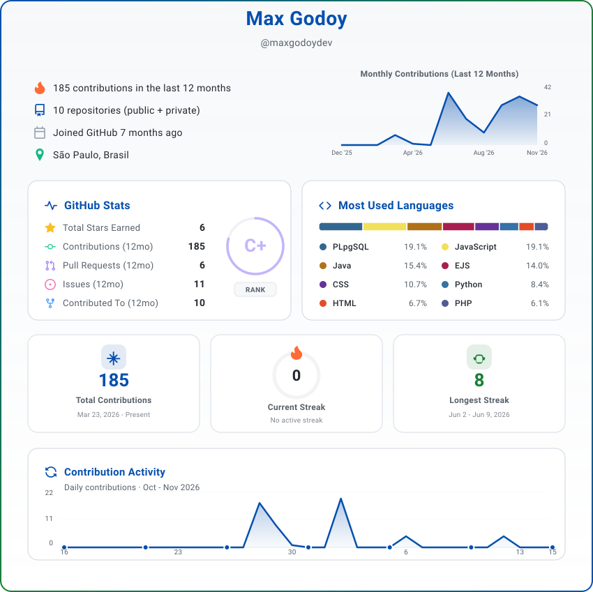

 
<picture>
  <source media="(prefers-color-scheme: light)" srcset="./assets/hero-light.svg?v=2">
  
</picture>

 

 

<table width="100%">
<tr>
<td width="33%" valign="top">

<h3 align="center">⏳ Experiência</h3>

<ul>
  <li><b>Cofundador e Coordenador de Projetos</b> — <a href="https://github.com/Luck16Ash/Segunda-Vitrine">Segunda Vitrine</a>, iniciativa estudantil independente</li>
  <li><b>9 anos em Legalização Empresarial</b>, com foco em processos, validação de dados e controles</li>
  <li><b>Transição de carreira</b> para Dados, Analytics e Business Intelligence</li>
</ul>

</td>
<td align="center" width="34%" valign="top">

### 🎓 Formação

**Desenvolvimento de Software Multiplataforma**

[FATEC Zona Sul](https://fateczonasul.edu.br/)

 

 
 

</td>
<td align="center" width="33%" valign="top">

### 🎯 Objetivo

Estágio em **Data Analytics | Business Intelligence | Engenharia de Dados**

 

**Stack principal**

 

🌎 Inglês intermediário (B1)

</td>
</tr>
</table>

 

## 🏆 Sistemas & Portfólios em Destaque

<table>
<thead>
<tr>
  <th align="center">Projeto</th>
  <th align="center">Tipo</th>
  <th align="center">Descrição</th>
  <th align="center">Tecnologias</th>
  <th align="center">Acesso</th>
</tr>
</thead>
<tbody>

<tr>
<td valign="middle"><a href="https://github.com/maxgodoydev/Business-Intelligence-portfolio"><b>📊 Business Intelligence Portfolio</b></a></td>
<td valign="middle" nowrap><b>📊 Portfólio de Business Intelligence</b></td>
<td valign="middle">Coleção de análises e dashboards que demonstram o ciclo completo de BI: tratamento dos dados, modelagem e visualização.</td>
<td valign="middle">

</td>
<td valign="middle" align="center">

</td>
</tr>

<tr>
<td valign="middle"><a href="https://github.com/maxgodoydev/Banking-analytics"><b>🏦 Banking Analytics</b></a></td>
<td valign="middle" nowrap><b>📈 Análise de dados</b></td>
<td valign="middle">Análise de transações bancárias fictícias (dados sintéticos) que responde a cinco perguntas de negócio com SQL (CTEs e funções de janela), gráficos e testes automatizados.</td>
<td valign="middle">

</td>
<td valign="middle" align="center">

</td>
</tr>

<tr>
<td valign="middle"><a href="https://github.com/maxgodoydev/python-lab"><b>🐍 Python Lab</b></a></td>
<td valign="middle" nowrap><b>📚 Repositório educacional</b></td>
<td valign="middle">Repositório educacional em construção, com exercícios resolvidos e comentados passo a passo, em duas trilhas: fundamentos de Python e Python aplicado a dados (Analytics, BI e Engenharia de Dados).</td>
<td valign="middle">

</td>
<td valign="middle" align="center">

</td>
</tr>

<tr>
<td valign="middle"><a href="https://github.com/maxgodoydev/Studio_Patty_Leao"><b>🦁 Studio Patty Leão</b></a></td>
<td valign="middle" nowrap><b>🖥️ Mini ERP web</b></td>
<td valign="middle">ERP simples para salão de beleza que conecta agendamento, atendimento, estoque, financeiro manual e BI: ao concluir um atendimento, os insumos saem do estoque e os dados alimentam os indicadores. Inclui vitrine de reservas presenciais e site institucional.</td>
<td valign="middle">

</td>
<td valign="middle" align="center">

</td>
</tr>

<tr>
<td valign="middle"><a href="https://github.com/maxgodoydev/Entrelacos"><b>🎀 EntreLaços</b></a></td>
<td valign="middle" nowrap><b>🌐 Vitrine digital</b></td>
<td valign="middle">Vitrine digital de presentes com filtros por categoria, detalhes de cada kit e pedido direto pelo WhatsApp.</td>
<td valign="middle">

</td>
<td valign="middle" align="center">

</td>
</tr>

<tr>
<td valign="middle"><a href="https://github.com/maxgodoydev/BarberShop-Do-Gui"><b>💈 BarberShop do Gui</b></a></td>
<td valign="middle" nowrap><b>💻 Aplicação web</b></td>
<td valign="middle">Sistema web para uma barbearia de bairro real, desenvolvido em grupo: o cliente agenda sem criar conta e a equipe acompanha agenda, estoque e indicadores. Minha frente: dados, Analytics e BI, com pipeline Python/Pandas, SQL analítico e medidas DAX.</td>
<td valign="middle">

</td>
<td valign="middle" align="center">

</td>
</tr>

<tr>
<td valign="middle"><a href="https://github.com/maxgodoydev/InteliBolsas"><b>🎓 InteliBolsas</b></a></td>
<td valign="middle" nowrap><b>💻 Aplicação web (CRUD)</b></td>
<td valign="middle">Plataforma CRUD para divulgação de bolsas de estudo e cursos, com áreas para aluno, instituição e administração. Projeto do 2º semestre, executado localmente.</td>
<td valign="middle">

</td>
<td valign="middle" align="center">

</td>
</tr>

<tr>
<td valign="middle"><a href="https://github.com/Luck16Ash/Segunda-Vitrine"><b>🛍️ Segunda Vitrine</b></a></td>
<td valign="middle" nowrap><b>🌐 Vitrine digital</b></td>
<td valign="middle">Iniciativa independente de estudantes de Desenvolvimento de Software Multiplataforma da FATEC Zona Sul que dá visibilidade a projetos e contribuições individuais e aproxima os alunos do mercado.</td>
<td valign="middle">

</td>
<td valign="middle" align="center">

</td>
</tr>

</tbody>
</table>

 

## 📊 GitHub em Números

 

## 📬 Vamos conversar?

Aberto a oportunidades de estágio, colaborações e projetos em tecnologia, dados e automação.

 

  
  
  

 

