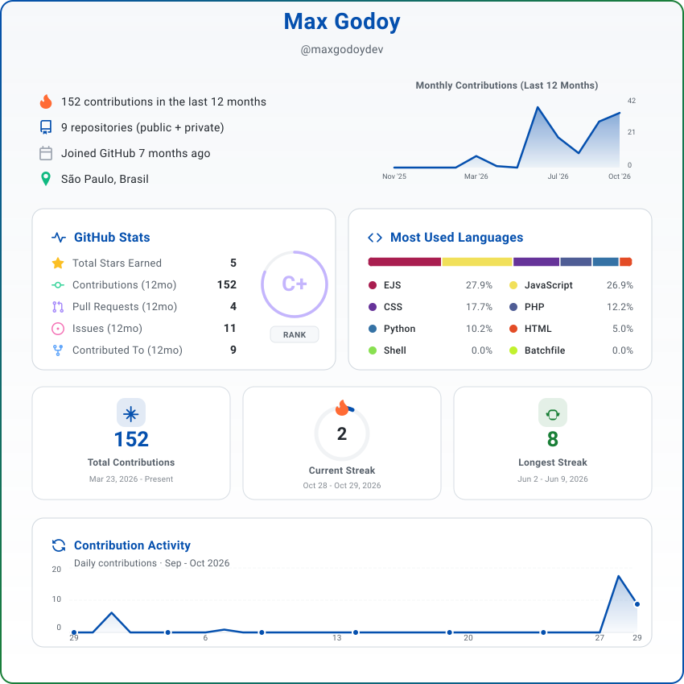

<picture>
  <source media="(prefers-color-scheme: light)" srcset="./assets/hero-light.svg">
  
</picture>

 

 

<table width="100%">
<tr>
<td align="center" width="33%" valign="top">

### ⏳ Experiência

Quase 9 anos em Legalização Empresarial, trabalhando com processos, regras de negócio, prazos e análise de riscos. Experiência que levo para a tecnologia junto com uma nova formação técnica.

</td>
<td align="center" width="34%" valign="top">

### 🎓 Formação

**Desenvolvimento de Software Multiplataforma**

[FATEC Zona Sul](https://fateczonasul.edu.br/)

 

</td>
<td align="center" width="33%" valign="top">

### 🎯 Objetivo

Estágio em **Dados, Analytics ou Business Intelligence**

</td>
</tr>
</table>

 

## 🏆 Sistemas & Portfólios em Destaque

| Sistema / Repositório | Descrição | Tecnologias | Acesso |
|:--|:--|:--|:--:|
| [**📊 Business Intelligence Portfolio**](https://github.com/maxgodoydev/Business-Intelligence-portfolio) | Portfólio de Dados, Analytics e BI, com análises e visualização de dados. |     |  |
| [**🏦 Banking Analytics**](https://github.com/maxgodoydev/banking-analytics) | Análises de dados no contexto bancário para explorar informações e apoiar decisões de negócio. |     |  |
| [**🐍 Python Data Studies**](https://github.com/maxgodoydev/python-data-studies) | Repositório de estudos de programação, lógica, análise de dados e estatística. |    |  |
| [**🦁 Studio Patty Leão**](https://github.com/maxgodoydev/Studio_Patty_Leao) | Sistema de gestão com vitrine digital, agendamentos e área institucional. |     |   |
| [**🎀 EntreLaços**](https://github.com/maxgodoydev/Entrelacos) | Vitrine digital de presentes com pedido pelo WhatsApp e pipeline em Python que valida o catálogo e analisa o funil de intenção. |      |   |

 

## 📊 GitHub em Números

 

## 📬 Vamos conversar?

Aberto a oportunidades de estágio, colaboração e sistemas nas áreas de tecnologia, dados e automação.

 

  

  

  

 

